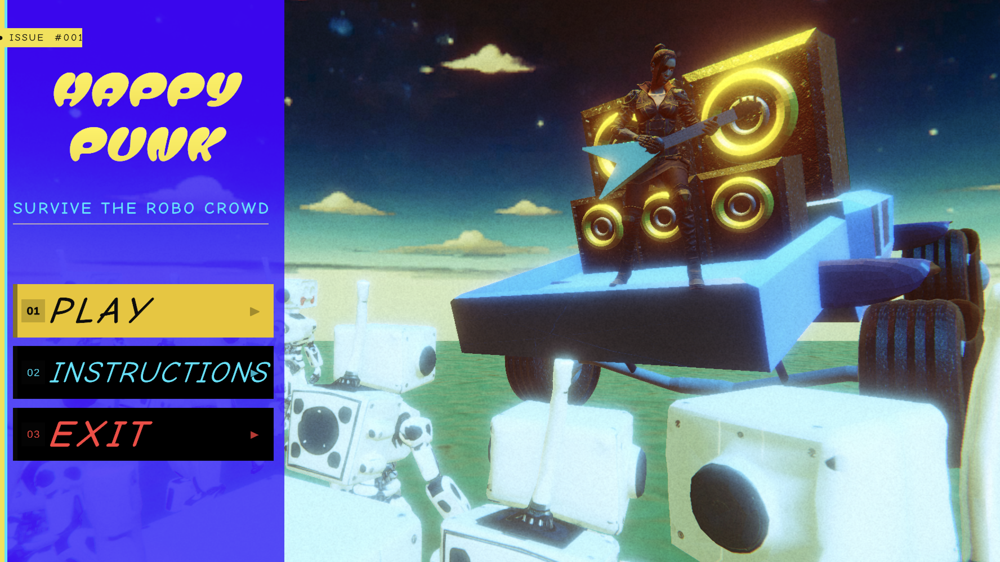
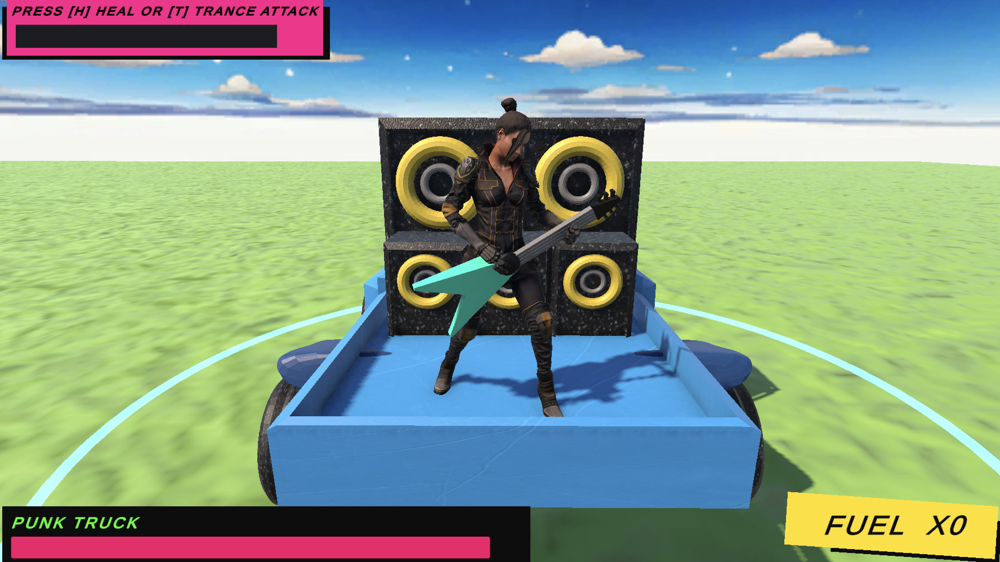
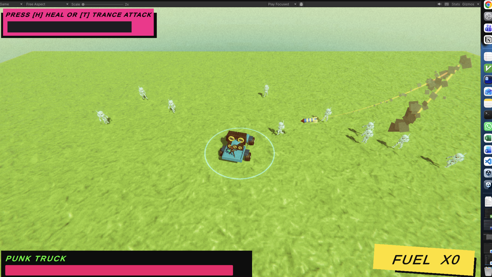
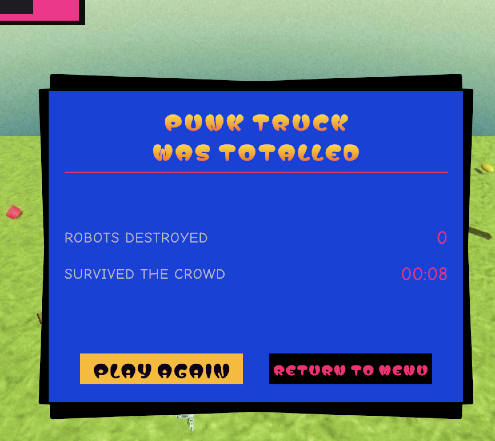

# Happy-Punk-WebGL

**Happy Punk** is a 3D arcade survival game built in Unity 6 (URP) for WebGL. You're a guitar-shredding punk riding a monster truck stacked with speakers, and an endless crowd of robots is closing in. Run them down, throw their own rockets back at them, and see how long you last.



## How to Play



Your truck always drives forward and steers toward your mouse cursor. Robots come in endless waves from every direction, and each wave is bigger than the last. Some of them fire rockets at you. If a robot touches you or a rocket hits you, the truck takes damage. The game ends when the truck's health bar runs out or you drive off the edge of the map.



### Controls

| Input | Action |
|-------|--------|
| **Mouse** | Steer the truck (it drives toward the cursor) |
| **Left Shift** | **Dash**: a burst of speed that destroys any robot you hit |
| **E** (hold / release) | When a rocket enters the circle around your truck, hold **E** to catch it in orbit, aim, then release to throw it back |
| **H** | **Heal**: restore 25% health (needs a full Kill Meter) |
| **T** | **Trance Attack**: a shockwave that wipes out every nearby robot (needs a full Kill Meter) |

### Mechanics

- **Kill Meter** (top-left): fills as you destroy robots and is full after 20 kills. Spend a full meter on **Heal [H]** or **Trance Attack [T]**.
- **Fuel Cores**: defeated robots drop fuel cores, and you pick them up by driving over them. When your Kill Meter is below 25%, a dash costs 10 fuel cores instead. Above 25%, dashing is free.
- **Punk Truck health** (bottom-left): keep it out of the red.

When the truck is totalled, you'll see how many robots you destroyed and how long you survived:



## How to Download and Play

### Requirements

- [Unity Hub](https://unity.com/download)
- **Unity 6000.0.61f1** with the **WebGL Build Support** module (needed only to build for the browser)

### 1. Clone the repo

```bash
git clone https://github.com/Jay-A-Kad/Happy-Punk-WebGL.git
cd Happy-Punk-WebGL
```

You can also click **Code → Download ZIP** on GitHub and extract it.

### 2. Play in the Unity Editor

1. Open **Unity Hub**, click **Add → Add project from disk**, and select the cloned folder.
2. Open it with Unity **6000.0.61f1**. The first import takes a few minutes.
3. In the Project window, open `Assets/Scenes/Menu.unity`.
4. Press **Play** and pick **PLAY** from the menu.

### 3. Build and play in the browser (WebGL)

1. Go to **File → Build Profiles** and choose **Web**. Make sure `Menu` and `MainPunkScene` are both in the scene list, with `Menu` first.
2. Click **Build** and pick an output folder, such as `Builds/WebGL`.
3. Serve the folder over a local web server. Opening `index.html` straight from disk won't work:
   ```bash
   cd Builds/WebGL
   python3 -m http.server 8000
   ```
4. Open <http://localhost:8000> in your browser and play.

> **Tip:** If the build uses Brotli compression and your server doesn't send the right headers, turn on **Decompression Fallback** in *Player Settings → Publishing Settings*, or use **Build And Run** from Unity.

## Tech

- Unity 6 · Universal Render Pipeline · WebGL
- NavMesh-driven robot AI with object pooling
- Cinemachine camera, TextMesh Pro UI, and a custom cartoon renderer feature
